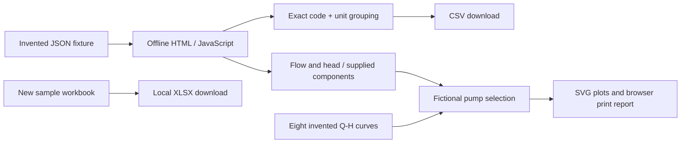

# Architecture

## Private application: verified structure

The application is a local Windows-oriented Python desktop program. PySide6 widgets present import, products, customers, spreadsheet comparison, submersible-pump sizing and centrifugal-pump selection. UI signals connect the workflows. Spreadsheet reading and comparison use worker objects and Qt threads; widgets are updated through the UI layer.

Service modules own spreadsheet import, material comparison, customer dossier operations, pump calculations and document export. Dataclasses carry structured values. A SQLite access layer manages products, suppliers, customers, file metadata, quotations, quotation items, pump models and curve points. Attachments live on the filesystem, with metadata stored in the database.

## Data flow

1. A product spreadsheet supplies catalog information. The importer normalizes column names, reads identifiers as text and validates rows.
2. A project material spreadsheet supplies requested items. Comparison services normalize requests, apply domain rules and separate matched and unresolved materials.
3. The operator reviews the result, adjusts items and can add selected pump components.
4. PDF exporters create quotations and material lists. Customer dossier operations associate copies of relevant files with a customer.
5. A separate legacy path stores quotation snapshots and exports them to Excel. That path is not shown as an active tab in the current main window.

Pump curve CSVs populate local technical tables. Pump services interpolate head at the requested flow within tabulated limits and filter candidates. The submersible workflow can derive head from well and pipe inputs; the current centrifugal screen receives flow and total head directly. A more extensive centrifugal calculation service is present in the source but should not be described as an exposed screen.

## Important boundaries

- A customer dossier can contain project files. There is no verified separate project entity with schedules, tasks or lifecycle states.
- Pump selection is a candidate-screening aid. It does not establish manufacturer approval or a complete installation design.
- The catalog comparison is heuristic and contains application-specific rules. This package does not disclose those mappings.
- Filesystem operations and database changes cross a consistency boundary. Some operations compensate for errors; the two stores are not one atomic transaction.
- The source contains tests. Their presence is not a claim about current full-suite pass status or measured coverage.

## Public demonstration: separate structure

The demo has no backend, private imports, database, telemetry, package dependencies, external assets or persistent customer storage. Reloading restores the fixtures. Independently written functions validate the invented catalog, interpolate piecewise-linear head and rank eligible models. A simplified system curve and numerical intersection are used only with supplied head components. Direct-head mode does not infer a system curve. SVG and print outputs use the last validated state. The code does not use private material mappings or manufacturer data.
