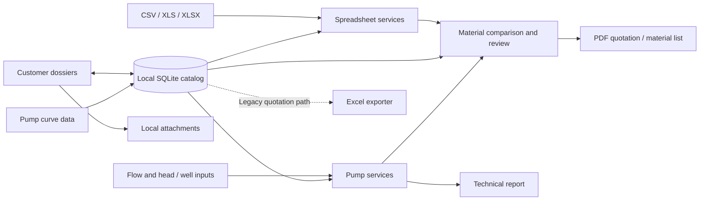
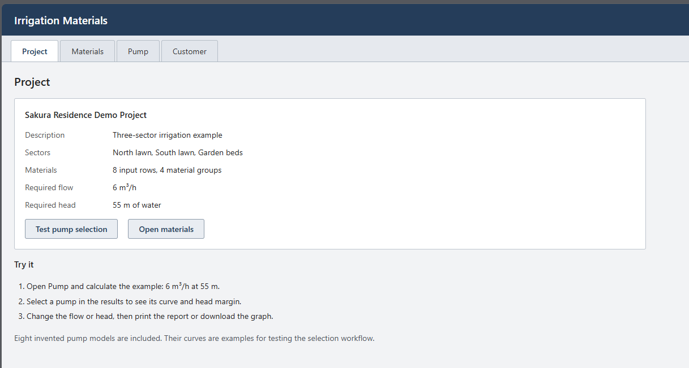
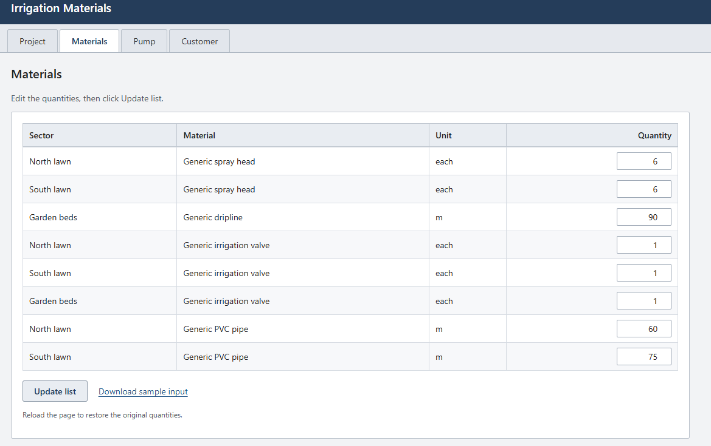
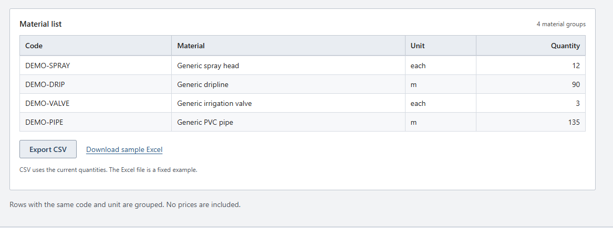
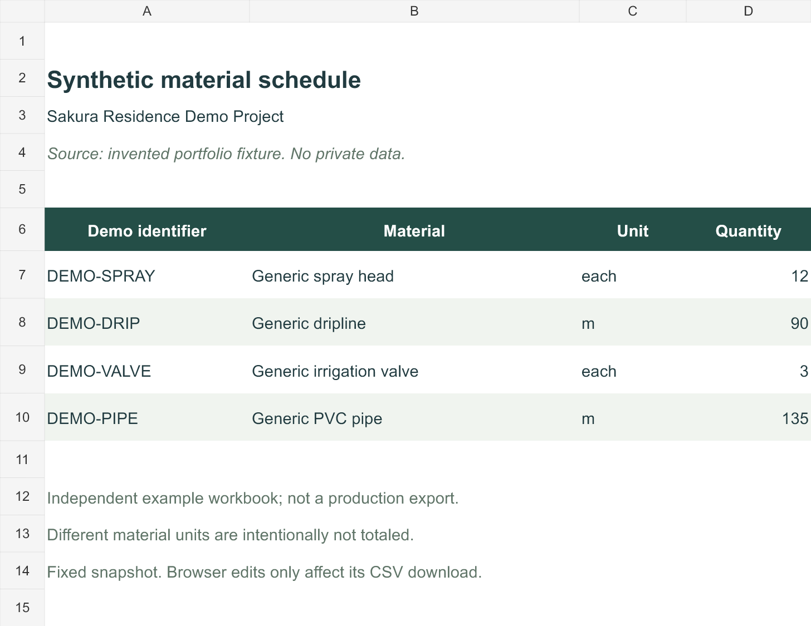
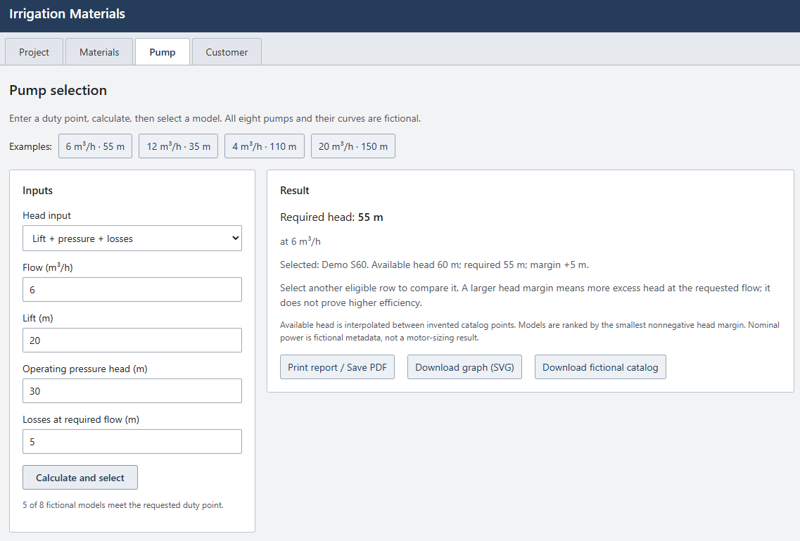
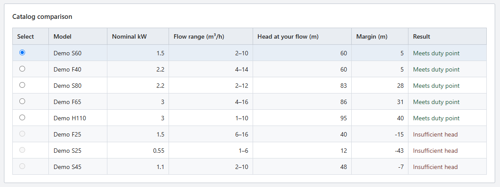
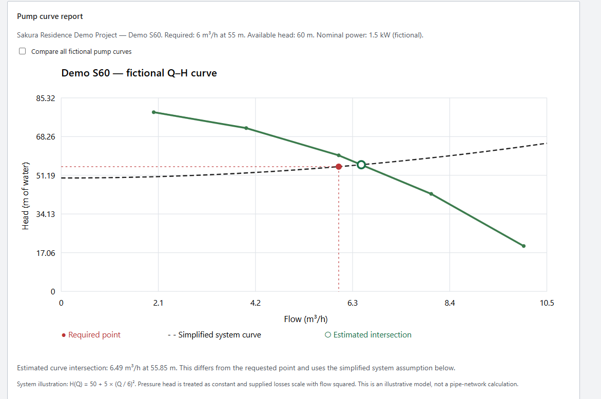
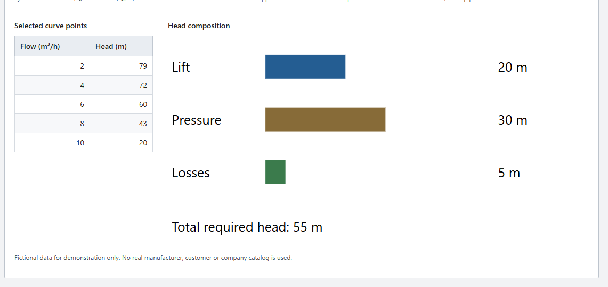
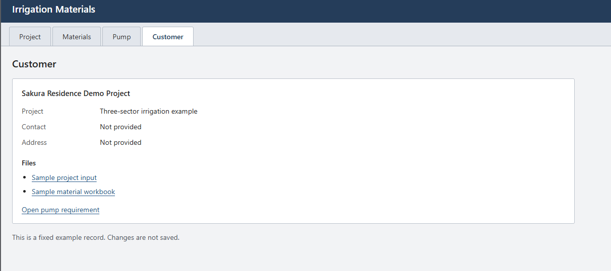

# Irrigation Project Automation Platform

Engineering workflow automation for irrigation design, material processing, hydraulic calculations and customer documentation.

## Overview

This case study describes an internal desktop application created to automate repetitive workflows in professional irrigation design.

Source code is private because this application is used internally in a commercial environment. This repository contains a technical case study built with synthetic data and contains no confidential customer or company information.

The included [offline demonstration](demo/index.html) is a separate, newly written illustration. Its interface and simplified logic are not the commercial application. Download this folder and open `demo/index.html` in a browser. No installation, account or connection is required. GitHub's file viewer displays the HTML source; it does not run the demo.

## Problem

Material lists from engineering work need to be reconciled with a commercial catalog, reviewed for unit and quantity differences, and turned into consistent documentation. Customer files and pump requirements must remain associated with that workflow. Repeating these steps manually creates opportunities for omissions and inconsistent records.

## Solution

The application combines spreadsheet import, catalog comparison, customer dossiers, material documentation and pump selection in a local desktop workflow. Items that cannot be resolved remain available for human review. Technical pump data and commercial product data serve different purposes: a technical candidate does not automatically have a known selling price.

## Verified features

| Capability | Verified scope |
| --- | --- |
| Spreadsheet processing | CSV, XLS and XLSX import with header normalization and row validation |
| Material comparison | Catalog matching, quantity/unit handling, domain-specific transformations and review of unresolved items |
| Documentation | Current comparison workflow exports PDF quotations and material lists without prices |
| Excel output | An openpyxl exporter and tests exist for saved quotations; the legacy quotation tab is currently hidden |
| Pump selection | Submersible and centrifugal candidates from tabulated curves, with interpolation inside the available flow range |
| Well hydraulics | A submersible-pump workflow calculates head and pipe losses from installation inputs |
| Customer dossiers | Customer records, categorized attachments, content-based duplicate detection and quotation links |

Direct CalcLANDSCAPE `.LND` parsing was **not found** in the inspected source. This case study demonstrates spreadsheet ingestion. It does not claim CAD geometry parsing, a CAD plug-in, a GIS engine or a full project-management system. A centrifugal hydraulic calculation service also exists, but the current centrifugal screen accepts an already consolidated flow/head point.

## Technical stack

The private application uses **Python, PySide6/Qt, SQLite, pandas, openpyxl and xlrd**. Qt's document and printing APIs generate PDFs. PyInstaller and PowerShell support Windows packaging. Tests use Python's `unittest` framework. The public demo uses only local HTML, CSS and JavaScript.

## Architecture

See [Architecture](ARCHITECTURE.md) for UI/service boundaries and feature limitations.

## Engineering challenges

- Turning inconsistent spreadsheet descriptions into structured material requests while keeping unresolved cases visible.
- Preserving unit meaning and material variants when grouping quantities.
- Keeping spreadsheet analysis off the GUI thread.
- Separating hydraulic suitability from catalog availability and price completeness.
- Keeping customer records, attachment copies and document exports consistent.

## Synthetic example

The **Sakura Residence Demo Project** has three fictional sectors. Eight input rows become four material groups: 12 spray heads, 90 m of dripline, 3 valves and 135 m of PVC piping. No prices are included.

The pump demo has **eight independently invented models with different Q-H curves**. Enter flow and total head, or add supplied lift, pressure head and losses. The app interpolates available head inside each curve's range, explains rejections, and ranks eligible models by the smallest nonnegative head margin. Select another eligible model, compare curves, export SVG or print the current report.

The default is **6 m³/h at 55 m**. Demo S60 supplies 60 m at that flow, giving a 5 m margin. The red point is the requested duty point. In component mode, an illustrative system curve scales supplied losses with flow squared and marks its estimated intersection separately. This assumption is written in the report; it is not a pipe-network calculation. Nominal powers and all pump data are invented.

Open **Pump**, choose an example or edit inputs, then click **Calculate and select**. Select a model in the table and use **Print report / Save PDF** or **Download graph (SVG)**. Changing inputs clears the previous curves until you recalculate. The flow is supplied independently of the material quantities.

Download the [synthetic input](demo-data/project.json), [material workbook](demo-data/materials-example.xlsx) or [CSV output](demo-data/materials-example.csv). The workbook is newly authored for the case study, not an export from the private application. See [data provenance](demo-data/README.md).

## Demonstration images

These images show the separate synthetic demo, **not the private application's interface**. The browser captures were supplied by the author after the navigation update. Material input and grouped results share the Materials tab. The workbook image is a render of the separate sample workbook.

## Privacy

No source from the private application, customer records, actual project files, supplier catalogs, company templates or branding is distributed here. This package contains only newly written narrative, demonstration code and invented data. See [Security and privacy](SECURITY_AND_PRIVACY.md).

## What I learned

I learned to translate an engineering workflow into software boundaries: inputs, domain rules, review states and document outputs. Material descriptions alone are not enough to establish equivalence; units, variants and commercial context matter. I also learned to keep long-running work separate from the UI and to make technical uncertainty visible rather than silently replacing missing information.

## Results and next steps

The implementation automates spreadsheet transformation, material documentation and several connected engineering tasks. No measured time savings, user counts or commercial outcomes are claimed. Future work includes clearer rule configuration, broader malformed-file tests, reproducible dependency versions and a packaging process that separates software from operational data.

Read the [detailed case study](CASE_STUDY.md) for the full discussion.
